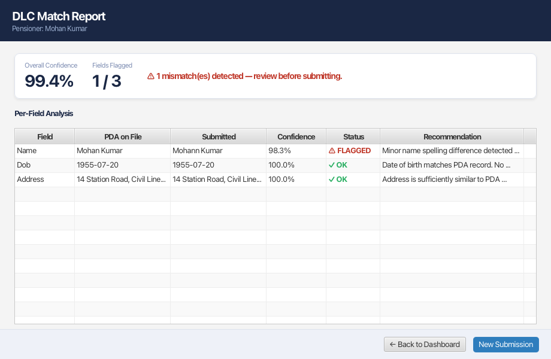

# PensionSure

Java desktop tool that checks a pensioner's Digital Life Certificate details against the pension-agency record before submission, using Jaro-Winkler and Levenshtein matching.

---

## Screenshots

### Discrepancy Match Report


### Multi-Pensioner Household Aggregation Dashboard


---

## Features

- **Field-Specific Fuzzy Matching:** Evaluates draft submissions against agency records using Jaro-Winkler (names), normalized Levenshtein (addresses), and 7-pattern ISO-8601 date parsing.
- **Semantic Formatting Detection:** Differentiates between non-damaging date notation differences (e.g. `15/03/1955` vs `1955-03-15`) and true identity discrepancies.
- **Household Aggregation:** Relational clustering of co-located family pensioners to coordinate DLC renewals in a single visit.
- **Submission Cutoff Tracking:** Real-time deadline monitoring calculating days remaining to the November 30 deadline with automated escalation levels.
- **Zero-Configuration Persistence:** Embedded SQLite engine automatically initializes tables with strict foreign key integrity on first run.

---

## Requirements

- **Java Development Kit (JDK):** JDK 17 or later (tested on OpenJDK 17 and OpenJDK 21 LTS).
- **Build System:** Apache Maven 3.9 or later.
- **GUI Environment:** A desktop display environment (macOS Aqua, Windows Desktop, or Linux X11/Wayland) is required to run `mvn javafx:run`.

---

## Quick Start

### 1. Run Unit Tests (19 tests)
```bash
mvn -B clean test
```

### 2. Launch the Application
```bash
mvn javafx:run
```

### 3. Build Executable Standalone JAR
```bash
mvn -B clean package
java -jar target/pensionsure-1.0-SNAPSHOT.jar
```

---

## Sample Input and Expected Output

Reference test cases are provided in [`samples/match-cases.csv`](samples/match-cases.csv):

| Case | Scenario | Submitted Input vs. Agency Baseline | Field Scores | Status | Action Guidance |
| :--- | :--- | :--- | :--- | :---: | :--- |
| **TC01** | Clean Match | "Ramesh Kumar Sharma", `1955-03-15`, "Flat 4B Sector 12 RK Puram" | Name: 1.000<br>DOB: 1.000<br>Addr: 1.000 | **PASS** | Ready for submission. |
| **TC02** | Name Typo | "Mohann Kumar" vs. "Mohan Kumar" | Name: **0.9667**<br>DOB: 1.000<br>Addr: 1.000 | **FLAGGED** | Clerical typo detected. Verify spelling with bank records. |
| **TC03** | Date Notation | "22/08/1958" vs. `1958-08-22` | Name: 1.000<br>DOB: **0.9000**<br>Addr: 1.000 | **FLAGGED** | Notation difference only. Auto-normalises to ISO-8601. |
| **TC04** | Street Num | "Flat 4C Sector 12" vs. "Flat 4B Sector 12" | Name: 1.000<br>DOB: 1.000<br>Addr: 0.9773 | **PASS** | Minor variation above 0.70 threshold. |

---

## How It Works

1. **Field-Specific Comparators:** Jaro-Winkler evaluates pensioner names with prefix-weighting, normalized Levenshtein evaluates residential addresses, and a 7-pattern normalizer standardizes dates to ISO-8601.
2. **Confidence Metric:** Composite confidence is the arithmetic mean of the three field scores; any score below 0.85 overall or containing a flagged field triggers an alert.
3. **Format vs. Fact Distinction:** Date entries representing the same calendar day in differing formats receive a 0.90 score and an auto-correction prompt rather than a rejection.
4. **Deadline Escalation:** The countdown to the November 30 cutoff categorizes urgency into `INFO` (> 14 days), `WARNING` (3 to 14 days), and `URGENT` (< 3 days or overdue).
5. **Household Clustering:** Relational foreign keys associate pensioners sharing an address into a unified household card to streamline verification.

---

## Configuration

No external configuration files or `.env` setups are required. On first startup, PensionSure automatically creates and bootstraps an embedded SQLite database named `pensionsure.db` in the current working directory.

---

## Limitations

- **Offline Baseline:** Records on file are manually entered or imported offline; the tool does not interface with live Pension Disbursing Agency (PDA) or bank core banking APIs.
- **Heuristic Thresholds:** Matching thresholds (0.85 name, 0.70 address, 0.85 overall) are heuristic indicators and do not guarantee acceptance by official portals.
- **Clerical Scope:** Compares three primary demographic fields (Name, DOB, Address); it does not validate biometric signatures, iris scans, or facial authentication.
- **Unofficial Tool:** PensionSure is an independent pre-screening utility and is not affiliated with the Government of India or the Jeevan Pramaan portal.
- **Single-User Desktop:** Designed as a single-operator desktop utility rather than a multi-tenant client-server system.

---

## License

This project is licensed under the [MIT License](LICENSE) — see the [LICENSE](LICENSE) file for details.  
Copyright (c) 2026 Srivarsan K V.

---

## Acknowledgements

- Fellegi, I. P., & Sunter, A. B. (1969). "A Theory for Record Linkage." *Journal of the American Statistical Association*, 64(328), 1183-1210.
- Jaro, M. A. (1989). "Advances in record-linkage methodology as applied to matching the 1985 Census of Tampa, Florida." *Journal of the American Statistical Association*, 84(406), 414-420.
- Winkler, W. E. (1990). "String Comparator Metrics and Enhanced Decision Rules in the Fellegi-Sunter Model of Record Linkage." *Proceedings of the Section on Survey Research Methods*, 354-359.
- Levenshtein, V. I. (1966). "Binary codes capable of correcting deletions, insertions, and reversals." *Soviet Physics Doklady*, 10(8), 707-710.
- AI coding tools were utilized in the development and documentation of portions of this codebase.
