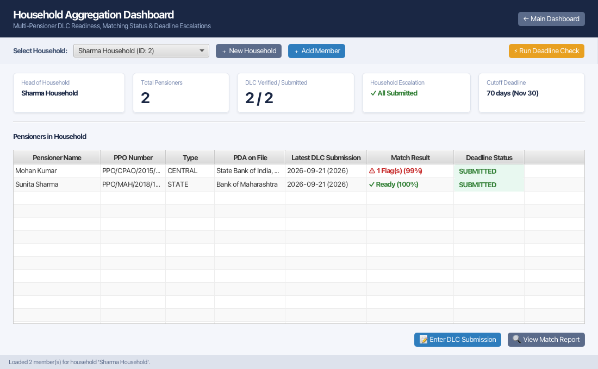
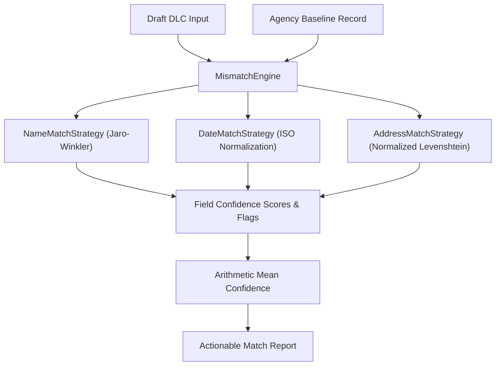

# PensionSure

> Java desktop tool that checks a pensioner's Digital Life Certificate details against the pension-agency record before submission, using Jaro-Winkler and Levenshtein matching.

[](https://github.com/srivarsan007/PensionSure/actions/workflows/ci.yml)
[](LICENSE)
[](https://adoptium.net)

---

## Pre-Submission Verification & Readiness




---

## Table of Contents

- [Why It Exists](#why-it-exists)
- [Features](#features)
- [Installation](#installation)
- [Troubleshooting](#troubleshooting)
- [Quick Usage](#quick-usage)
- [How It Works](#how-it-works)
- [Sample Data](#sample-data)
- [Project Structure](#project-structure)
- [Testing](#testing)
- [Roadmap](#roadmap)
- [Contributing, Security & License](#contributing-security--license)
- [Disclaimer](#disclaimer)
- [Acknowledgements & References](#acknowledgements--references)

---

## Why It Exists

In India, millions of central, state, and defence pensioners must submit an annual Digital Life Certificate (DLC / *Jeevan Pramaan*) every November to ensure uninterrupted pension disbursements. Submissions frequently fail or face rejection not due to identity fraud, but because of subtle clerical variations between submission drafts and historical Pension Disbursing Agency (PDA) records. Common issues include phonetic transliteration differences in English names, alternative date notation conventions (`DD/MM/YYYY` vs. `YYYY-MM-DD`), and minor residential address abbreviations.

PensionSure acts as an offline, pre-flight triage assistant. By catching clerical discrepancies and evaluating deadline urgency before formal submission attempts, it protects vulnerable pensioners from avoidable delays and pension payment lapses.

---

## Features

- **Field-Specific Fuzzy Matching:** Evaluates draft submissions against agency records using Jaro-Winkler (names), length-normalized Levenshtein (addresses), and 7-pattern ISO-8601 date parsing.
- **Two-Tier Date Discrepancy Detection:** Distinguishes between harmless date formatting variants (e.g., `15/03/1955` vs `1955-03-15`, assigned a 0.90 format score with auto-correction guidance) and true identity discrepancies.
- **Multi-Pensioner Household Aggregation:** Relational grouping of co-located family beneficiaries to coordinate renewals in a single outreach visit.
- **Cutoff Deadline Monitoring:** Evaluates remaining days against the statutory November 30 cutoff with three-tier escalation alerts (`INFO`, `WARNING`, `URGENT`).
- **Zero-Configuration Embedded SQLite:** Automatically bootstraps database schema with strict foreign key integrity in the working directory on launch.

---

## Installation

### Option 1: Download Standalone Executable JAR

Download the standalone executable JAR tailored for your operating system from the [Releases](https://github.com/srivarsan007/PensionSure/releases) page. Each package bundles the required platform-specific JavaFX native libraries and an embedded SQLite runtime:

| Operating System | Architecture | Executable Package | Checksum |
| :--- | :--- | :--- | :--- |
| **Linux** | x86_64 | `pensionsure-1.0.2-linux.jar` | `pensionsure-1.0.2-linux.jar.sha256` |
| **Windows** | x86_64 | `pensionsure-1.0.2-windows.jar` | `pensionsure-1.0.2-windows.jar.sha256` |
| **macOS** (Apple Silicon) | `aarch64` (M1/M2/M3/M4) | `pensionsure-1.0.2-macos-arm64.jar` | `pensionsure-1.0.2-macos-arm64.jar.sha256` |
| **macOS** (Intel) | `x86_64` | `pensionsure-1.0.2-macos-x64.jar` | `pensionsure-1.0.2-macos-x64.jar.sha256` |

Launch the downloaded JAR directly with Java 17+:
```bash
java -jar pensionsure-1.0.2-<os>.jar
```

### Option 2: Run from Source (Fallback)

If you prefer to run directly from source or develop locally, ensure Java 17+ and Git are installed:

```bash
git clone https://github.com/srivarsan007/PensionSure.git
cd PensionSure
./mvnw javafx:run
```

To build a standalone package locally for your current host platform:
```bash
./mvnw -B clean package
java -jar target/pensionsure-1.0.2.jar
```

### Troubleshooting

- **`JAVA_HOME` Not Set or Outdated:**
  PensionSure requires JDK 17 or newer. If executing `./mvnw` or `java -jar` returns an error about locating a Java runtime or incompatible class versions:
  - On macOS / Linux:
    ```bash
    export JAVA_HOME="/path/to/jdk-17-or-newer"
    ```
    For example on macOS with Homebrew OpenJDK:
    ```bash
    export JAVA_HOME="$(/usr/libexec/java_home -v 17+ 2>/dev/null || echo '/opt/homebrew/opt/openjdk@21')"
    ```
  - On Windows (PowerShell):
    ```powershell
    $env:JAVA_HOME = "C:\Program Files\Eclipse Adoptium\jdk-17..."
    ```

---

## Quick Usage

1. **Launch the Application:** Run `./mvnw javafx:run` (or launch the standalone JAR).
2. **Select Records & Submissions:** Select an existing pensioner or enter a new demographic baseline record and draft DLC details.
3. **Analyze Match Report:** Click **Check DLC Readiness** to inspect similarity scores, discrepancy flags, and actionable guidance before submitting to the portal.

---

## How It Works



1. **Jaro-Winkler for Names:** Gives prefix-weighted preference to initial characters, reflecting name stability in Indian transliteration. Any score below 1.0 triggers an operator verification flag.
2. **Normalized Levenshtein for Addresses:** Normalizes raw edit cost by maximum string length (`1.0 - (editDistance / maxLen)`). A threshold of 0.70 absorbs standard street abbreviations ("Rd", "Ngr") without failing valid entries.
3. **ISO-8601 Date Normalization:** Validates and standardizes 7 common date patterns into ISO-8601 `YYYY-MM-DD`. Matching calendar dates with differing notation receive a 0.90 format score.
4. **Overall Confidence:** Calculated as the unweighted arithmetic mean of the name, date, and address scores.
5. **Cutoff Escalation:** Evaluates calendar days remaining before November 30:
   - `INFO`: > 14 days remaining
   - `WARNING`: 3 to 14 days remaining
   - `URGENT`: < 3 days remaining, deadline day, or overdue

---

## Sample Data

Benchmark data files are provided in the [`samples/`](samples/) directory:
- [`samples/match-cases.csv`](samples/match-cases.csv): Deterministic test scenarios validating clean matches, name typos, date format differences, and address variations.
- [`samples/seed-data.sql`](samples/seed-data.sql): Seed database script containing sample households, pensioner demographics, and baseline agency records for offline testing.

---

## Project Structure

```
PensionSure
├── .github/              # GitHub Actions CI, CodeQL, release, issue & PR templates
├── docs/
│   ├── images/           # UI screenshots and documentation diagrams
│   ├── design-notes.md   # Architectural decisions and technical trade-offs
│   └── limitations.md    # Boundary conditions and out-of-scope capabilities
├── samples/
│   ├── match-cases.csv   # Deterministic benchmark match cases
│   └── seed-data.sql     # Offline database seed script
├── src/
│   ├── main/java/        # Domain entities, fuzzy matching, repositories, UI controllers
│   ├── main/resources/   # JavaFX FXML layouts and stylesheets
│   └── test/java/        # JUnit 5 test suite and benchmark CSV validation
├── pom.xml               # Maven POM configuration
├── mvnw / mvnw.cmd       # Official Maven Wrapper executables
├── LICENSE               # MIT License
├── CHANGELOG.md          # Version history
├── CONTRIBUTING.md       # Contribution guidelines
├── CODE_OF_CONDUCT.md    # Community standards
└── SECURITY.md           # Vulnerability disclosure policy
```

---

## Testing

Run the automated test suite across all 19 unit and benchmark tests:
```bash
./mvnw -B test
```

Execute full verification and packaging:
```bash
./mvnw -B clean verify
```

---

## Roadmap

- **OCR Form Pre-Filling:** Optical character recognition to extract demographic fields from scanned PPO letters or Aadhaar cards.
- **Agency Data Connectors:** Direct read-only adapter integration with standardized pension management databases.
- **Automated Messaging Reminders:** SMS and email notification dispatcher for household deadline escalation alerts.
- **Extended Field Comparison:** Expand fuzzy screening to bank branch IFSC codes and relationship titles.

---

## Contributing, Security & License

- **Contributing:** Contributions are welcome! Please read [CONTRIBUTING.md](CONTRIBUTING.md) and [CODE_OF_CONDUCT.md](CODE_OF_CONDUCT.md) before opening a pull request.
- **Security:** To report a vulnerability, follow our [SECURITY.md](SECURITY.md) private disclosure process.
- **License:** Licensed under the [MIT License](LICENSE). Copyright (c) 2026 Srivarsan K V.

---

## Disclaimer

PensionSure is an independent open-source software project. It is **not** an official application of, nor is it affiliated with, endorsed by, or connected to the Government of India, the Department of Pension & Pensioners' Welfare (DoPPW), the National Informatics Centre (NIC), or the Jeevan Pramaan portal. This software does not submit certificates directly to disbursing agencies and is not a substitute for official biometric authentication.

---

## Acknowledgements & References

- Fellegi, I. P., & Sunter, A. B. (1969). "A Theory for Record Linkage." *Journal of the American Statistical Association*, 64(328), 1183–1210.
- Jaro, M. A. (1989). "Advances in record-linkage methodology as applied to matching the 1985 Census of Tampa, Florida." *Journal of the American Statistical Association*, 84(406), 414–420.
- Winkler, W. E. (1990). "String Comparator Metrics and Enhanced Decision Rules in the Fellegi-Sunter Model of Record Linkage." *Proceedings of the Section on Survey Research Methods*, 354–359.
- Levenshtein, V. I. (1966). "Binary codes capable of correcting deletions, insertions, and reversals." *Soviet Physics Doklady*, 10(8), 707–710.
- AI coding tools were used in the development and technical documentation of this codebase.
